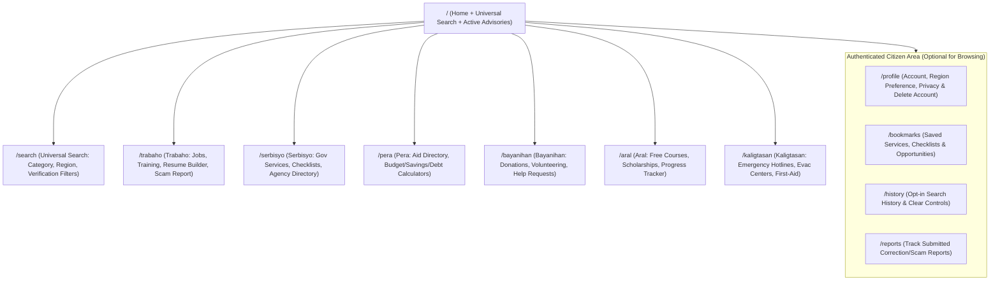

# GabayPH: Repository Audit & Master Architecture Specification

> [!IMPORTANT]
> **Phase 0 Deliverable — For Review & Approval**
> Per Section 17 of the Project Master Specification, no application code or database migrations have been executed yet. Please review this architecture plan and click **Proceed** (or reply with adjustments) to begin Phase 1 implementation directly in [`/home/antigravity/DietherFernandez/Bayanihan-Hub`](file:///home/antigravity/DietherFernandez/Bayanihan-Hub).

---

## 1. Current Repository Assessment

### Repository Inspection Summary
- **Repository Path**: [`/home/antigravity/DietherFernandez/Bayanihan-Hub`](file:///home/antigravity/DietherFernandez/Bayanihan-Hub)
- **Remote Origin**: `https://github.com/DietherFernandez/Bayanihan-Hub.git`
- **Git State**: Uninitialized `main` branch (`0` commits, `0` branches pushed, `0` tracked files).
- **Existing Framework / Dependencies**: None present yet (greenfield repository).
- **Host Environment Capabilities**:
  - Node.js `v24.x` LTS, `npm`, `pnpm`, `yarn` pre-installed
  - Git and GitHub CLI (`gh`) authenticated and connected to `DietherFernandez/Bayanihan-Hub`
- **Preservation & Risk Assessment**:
  - Because the repository is completely empty, there is zero risk of overwriting legacy code.
  - **Key Architectural Risks to Mitigate Early**:
    1. **Unverified Public Information Risk**: Government requirements, fees, and hotlines can become outdated or inaccurate. *Mitigation*: Enforce database-level verification statuses (`officially_verified`, `verification_pending`, `archived`), mandatory `source_url`, and `last_verified_at` fields on every public record.
    2. **Supabase Connectivity in Local/Preview Modes**: Before live Supabase credentials are provided or when running offline/CI builds, the app must not crash. *Mitigation*: Strict Zod environment validation paired with a clean fallback/seed data reader layer and local Supabase migration scripts so development, testing, and builds work deterministically.
    3. **Mobile Bandwidth & Low-End Device Constraints**: Many Filipino users access services via budget smartphones on 3G/4G data. *Mitigation*: Server Components by default, minimal client JS bundles, tabular/list layouts instead of heavy media cards, and URL-driven search/filter state.

---

## 2. Proposed Project Folder Structure

We will scaffold the project directly at the repository root [`/home/antigravity/DietherFernandez/Bayanihan-Hub`](file:///home/antigravity/DietherFernandez/Bayanihan-Hub) using **Next.js (App Router) + TypeScript + Tailwind CSS + shadcn/ui**.

```text
Bayanihan-Hub/
├── .env.example                      # Documented environment variable template
├── next.config.ts                    # Security headers, strict mode, image policies
├── package.json
├── tsconfig.json
├── supabase/
│   ├── config.toml                   # Supabase local CLI configuration
│   ├── migrations/
│   │   ├── 0001_enums_and_extensions.sql
│   │   ├── 0002_core_tables.sql
│   │   ├── 0003_rls_policies.sql
│   │   └── 0004_indexes_and_search.sql
│   └── seed.sql                      # Verified initial Philippine gov agencies, hotlines & services
├── src/
│   ├── env.ts                        # Zod-validated server & client environment variables
│   ├── middleware.ts                 # Supabase session refresh, route protection, rate-limit headers
│   ├── app/
│   │   ├── layout.tsx                # Root layout, accessible skip-link, system font setup
│   │   ├── page.tsx                  # Public homepage: Universal Search, quick directories, advisories
│   │   ├── (public)/                 # Publicly accessible modules (no login required)
│   │   │   ├── search/               # Universal Search results & multi-faceted filtering
│   │   │   ├── trabaho/              # Module A: Jobs, Scholarships/Training, Resume Builder, Scam Report
│   │   │   ├── serbisyo/             # Module B: Gov Service Directory, Checklists, Agency Guides
│   │   │   ├── pera/                 # Module C: Financial Aid Directory, Budget/Savings/Debt Calculators
│   │   │   ├── bayanihan/            # Module D: Community Donations, Volunteering, Help Requests, Orgs
│   │   │   ├── aral/                 # Module E: Free Learning, Scholarships, Online Training & Progress
│   │   │   └── kaligtasan/           # Module F: Emergency Hotlines, Evac Centers, First-Aid, Advisories
│   │   ├── (auth)/                   # Authentication flows
│   │   │   ├── login/
│   │   │   ├── register/
│   │   │   └── auth/callback/        # Supabase OAuth / magic link / email verification callback
│   │   ├── (citizen)/                # Authenticated citizen workspace
│   │   │   ├── profile/              # Profile settings, privacy controls, account deletion
│   │   │   ├── bookmarks/            # Saved services, jobs, programs, and checklists
│   │   │   ├── history/              # Search history with opt-in/clear controls
│   │   │   └── reports/              # Submitted inaccuracy / scam reports tracker
│   │   ├── (admin)/                  # Protected role-based Admin Dashboard (/admin/*)
│   │   │   └── admin/
│   │   │       ├── layout.tsx        # Server-enforced RBAC guard (Super Admin, Content Admin, Moderator)
│   │   │       ├── page.tsx          # Admin Overview & verification queue metrics
│   │   │       ├── users/
│   │   │       ├── resources/
│   │   │       ├── jobs/
│   │   │       ├── scholarships/
│   │   │       ├── assistance/
│   │   │       ├── organizations/
│   │   │       ├── moderation/
│   │   │       ├── reports/
│   │   │       ├── announcements/
│   │   │       ├── verification/
│   │   │       ├── audit-logs/
│   │   │       └── settings/
│   │   └── api/
│   │       ├── search/route.ts       # Fast universal search endpoint with rate limiting
│   │       ├── health/route.ts       # System check endpoint
│   │       └── assistant/route.ts    # Optional Phase-Future Gemini AI guide boundary (feature-flagged)
│   ├── components/
│   │   ├── ui/                       # Accessible shadcn/ui primitives (Button, Input, Table, Badge, Dialog, etc.)
│   │   ├── layout/                   # Header, Compact Mobile Bar, Breadcrumbs, Footer, Official Banner
│   │   ├── trust/                    # VerificationBadge, SourceCitationBar, OutdatedBanner, ReportIssueModal
│   │   ├── search/                   # UniversalSearchBar, FilterRail, SearchResultRow
│   │   ├── calculators/              # Interactive Pera tools (Budget, Savings, Debt Repayment)
│   │   └── resume/                   # Accessible printable Resume Builder (Trabaho module)
│   ├── lib/
│   │   ├── supabase/
│   │   │   ├── client.ts             # Browser client (anon key only)
│   │   │   ├── server.ts             # Server component / Server Action client with cookie handling
│   │   │   └── admin.ts              # Strictly server-only service-role client (never imported in client)
│   │   ├── auth/
│   │   │   └── rbac.ts               # Role-checking utilities & server action guards
│   │   ├── validations/              # Zod schemas for every form, filter, and mutation
│   │   ├── security/                 # Sanitization, rate-limiter, Turnstile verifier, audit logger
│   │   └── constants/                # Verified national hotlines (911, 143, 8888, NDRRMC) & PH regions
│   └── types/
│       └── database.ts               # Strict TypeScript definitions matching PostgreSQL schema
```

---

## 3. Database Schema Proposal (PostgreSQL + Supabase RLS)

### 3.1 Custom Enums & Extensions
- `pg_trgm` and `unaccent` enabled for fast Filipino/English full-text and fuzzy search.
- **`user_role`**: `'super_admin' | 'content_admin' | 'regional_moderator' | 'organization' | 'citizen'`
- **`verification_status`**: `'officially_verified' | 'verification_pending' | 'archived'`
- **`record_status`**: `'draft' | 'published' | 'under_review' | 'rejected' | 'archived'`
- **`module_type`**: `'trabaho' | 'serbisyo' | 'pera' | 'bayanihan' | 'aral' | 'kaligtasan'`
- **`opportunity_type`**: `'job' | 'scholarship' | 'training' | 'volunteer'`
- **`bayanihan_type`**: `'donation_offer' | 'assistance_request' | 'volunteer_call'`
- **`report_reason`**: `'outdated_info' | 'incorrect_requirements' | 'broken_link' | 'suspected_scam' | 'abusive_content' | 'other'`

### 3.2 Entity-Relationship Diagram

```mermaid
erDiagram
    PROFILES ||--o{ ORGANIZATIONS : "owns/manages"
    PROFILES ||--o{ BOOKMARKS : "saves"
    PROFILES ||--o{ REPORTS : "submits"
    PROFILES ||--o{ VERIFICATION_LOGS : "verifies"
    PROFILES ||--o{ AUDIT_LOGS : "triggers"
    LOCATIONS ||--o{ PROFILES : "resides_in"
    LOCATIONS ||--o{ RESOURCES : "covers"
    LOCATIONS ||--o{ OPPORTUNITIES : "located_in"
    LOCATIONS ||--o{ ASSISTANCE_PROGRAMS : "covers"
    CATEGORIES ||--o{ RESOURCES : "classifies"
    CATEGORIES ||--o{ OPPORTUNITIES : "classifies"
    ORGANIZATIONS ||--o{ RESOURCES : "publishes"
    ORGANIZATIONS ||--o{ OPPORTUNITIES : "offers"
    ORGANIZATIONS ||--o{ ASSISTANCE_PROGRAMS : "administers"

    PROFILES {
        uuid id PK "References auth.users(id)"
        user_role role "Default: citizen"
        text full_name
        uuid location_id FK
        boolean save_search_history "Default: false (privacy-first)"
        timestamptz created_at
        timestamptz updated_at
    }

    LOCATIONS {
        uuid id PK
        text psgc_code UK "Philippine Standard Geographic Code"
        text region_code "e.g., NCR, Region IV-A"
        text region_name
        text province
        text city_municipality
        boolean is_national "True for nationwide coverage"
    }

    CATEGORIES {
        uuid id PK
        module_type module
        text slug UK
        text name_en
        text name_fil
        text description
        int display_order
    }

    ORGANIZATIONS {
        uuid id PK
        text name
        text slug UK
        text org_type "gov_agency | lgu | ngo | employer | school"
        text official_website
        text verified_email_domain
        verification_status verification_status
        uuid owner_id FK
        uuid location_id FK
        timestamptz last_verified_at
        timestamptz created_at
        timestamptz updated_at
    }

    RESOURCES {
        uuid id PK
        module_type module "serbisyo | pera | aral | kaligtasan | bayanihan"
        uuid category_id FK
        uuid organization_id FK
        uuid location_id FK
        text slug UK
        text title
        text summary
        jsonb requirements_checklist "Structured document checklist"
        jsonb steps_json "Step-by-step instructions"
        text eligibility_summary
        text processing_time
        text fees_summary
        text source_name "Required"
        text source_url "Required official link"
        jsonb contact_info "Verified hotlines/emails only"
        verification_status verification_status
        record_status status
        timestamptz last_verified_at
        uuid created_by FK
        uuid verified_by FK
        tsvector search_vector "Indexed FTS column"
        timestamptz created_at
        timestamptz updated_at
    }

    OPPORTUNITIES {
        uuid id PK
        opportunity_type type "job | scholarship | training | volunteer"
        uuid category_id FK
        uuid organization_id FK
        uuid location_id FK
        text slug UK
        text title
        text description
        jsonb requirements
        text compensation_or_benefit "Salary range or scholarship grant"
        text application_url
        timestamptz deadline_at
        boolean is_remote
        text source_name
        text source_url
        verification_status verification_status
        record_status status
        timestamptz last_verified_at
        uuid created_by FK
        tsvector search_vector
        timestamptz created_at
        timestamptz updated_at
    }

    ASSISTANCE_PROGRAMS {
        uuid id PK
        uuid organization_id FK
        uuid location_id FK
        text slug UK
        text program_name
        text program_type "medical | educational | burial | cash_aid | calamity | livelihood"
        text description
        jsonb eligibility_criteria
        jsonb required_documents
        text how_to_apply
        text source_name
        text source_url
        verification_status verification_status
        record_status status
        timestamptz last_verified_at
        tsvector search_vector
        timestamptz created_at
        timestamptz updated_at
    }

    BOOKMARKS {
        uuid id PK
        uuid user_id FK
        text target_type "resource | opportunity | assistance_program"
        uuid target_id
        text notes
        timestamptz created_at
    }

    REPORTS {
        uuid id PK
        uuid reporter_id FK "Nullable for anonymous public reports"
        text target_type "resource | opportunity | assistance_program | organization"
        uuid target_id
        report_reason reason
        text details
        text evidence_url
        text resolution_status "open | investigating | resolved | dismissed"
        uuid resolved_by FK
        text resolution_notes
        timestamptz created_at
        timestamptz updated_at
    }

    ANNOUNCEMENTS {
        uuid id PK
        text title
        text body
        text severity "info | warning | emergency"
        module_type related_module
        uuid location_id FK
        text source_name
        text source_url
        verification_status verification_status
        timestamptz starts_at
        timestamptz expires_at "Auto-archives after expiry"
        uuid created_by FK
        timestamptz created_at
        timestamptz updated_at
    }

    VERIFICATION_LOGS {
        uuid id PK
        text target_type
        uuid target_id
        verification_status previous_status
        verification_status new_status
        text verification_notes
        text official_reference_url
        uuid verified_by FK
        timestamptz created_at
    }

    AUDIT_LOGS {
        uuid id PK
        uuid actor_id FK
        user_role actor_role
        text action "e.g., resource.verify, user.role_change, report.resolve"
        text entity_type
        uuid entity_id
        jsonb metadata "Redacted diff, never stores secrets/PII"
        timestamptz created_at
    }
```



### 3.3 Additional Supporting Tables for User & Community Features
To ensure all 6 modules and Section 7 user features have full persistence:
- **`bayanihan_posts`**: Community donation offers, volunteer calls, and assistance requests with mandatory moderation workflow (`status: 'under_review'` until approved by a Regional Moderator or Admin).
- **`search_history`**: Opt-in user search queries (`user_id`, `query`, `filters_json`, `created_at`) with one-click purge and strict self-only RLS.
- **`learning_progress`**: Tracks user completion of Aral resources and downloadable checklists (`user_id`, `resource_id`, `progress_state`, `completed_steps_json`).

### 3.4 Row Level Security (RLS) Policy Matrix

| Table | Anonymous (`anon`) | Authenticated Citizen | Organization Role | Moderator / Content Admin / Super Admin |
| :--- | :--- | :--- | :--- | :--- |
| `profiles` | None | `SELECT`, `UPDATE`, `DELETE` own row (`auth.uid() = id`). Cannot alter `role`. | Own row only | `Super Admin` can read/update roles; logged in `audit_logs`. |
| `locations`, `categories` | `SELECT` all | `SELECT` all | `SELECT` all | `Content Admin` & `Super Admin` full CRUD. |
| `resources`, `opportunities`, `assistance_programs` | `SELECT` where `status = 'published'` | `SELECT` where `status = 'published'` | `SELECT` published + `INSERT`/`UPDATE` own org drafts (`status = 'under_review'`) | Full CRUD + status/verification transitions. |
| `organizations` | `SELECT` where `verification_status != 'archived'` | `SELECT` active orgs | `UPDATE` own organization details | Verify/suspend organizations. |
| `bookmarks`, `search_history`, `learning_progress` | None | Full CRUD where `auth.uid() = user_id` | Full CRUD own rows | **No access** to private user bookmarks or search history. |
| `reports` | `INSERT` (rate-limited + Turnstile) | `INSERT` + `SELECT` own submitted reports | `SELECT` own submitted reports | `SELECT` & `UPDATE` resolution status. |
| `announcements` | `SELECT` active & non-expired | `SELECT` active & non-expired | `SELECT` active | Full CRUD + expiry management. |
| `verification_logs` | `SELECT` (public transparency trail) | `SELECT` | `SELECT` | `INSERT` only (append-only log). |
| `audit_logs` | None | None | None | `SELECT` (`Super Admin` only), `INSERT` via server triggers/actions. |

---

## 4. User and Admin Navigation Map

### 4.1 Public & Citizen Navigation Architecture
Designed for thumb-friendly mobile navigation (no full-screen modals) and clear desktop hierarchy:



- **Top Utility Bar**: Official Trust Banner ("GabayPH — Free Public Information & Community Guide • Verified Sources Linked") + Quick Emergency Button (`Kaligtasan / 911 Hotlines` always 1 tap away) + Language Toggle (`English / Filipino` labels).
- **Main Header**: Brand mark, inline Universal Search input, Desktop Module Links (`Trabaho`, `Serbisyo`, `Pera`, `Bayanihan`, `Aral`, `Kaligtasan`), User Account Menu.
- **Mobile Navigation (`< 768px`)**: Compact sticky bottom navigation bar with 5 core destinations (`Home`, `Search`, `Serbisyo`, `Modules Drawer/Sheet`, `Saved/Profile`) + persistent top `Emergency Hotlines` pill.

### 4.2 Protected Admin Dashboard Navigation (`/admin/*`)
Accessible only to `super_admin`, `content_admin`, and `regional_moderator` (with role-scoped permissions):

1. `/admin` — **Overview**: Pending verifications, open inaccuracy/scam reports, unmoderated Bayanihan posts, expiring announcements.
2. `/admin/verification` — **Content Verification Queue**: Side-by-side comparison of resource claims vs. official `.gov.ph` source URL; one-click verify or archive with mandatory `verification_logs` entry.
3. `/admin/resources` — **Resource Management**: CRUD for `Serbisyo`, `Pera`, `Aral`, and `Kaligtasan` guides and checklists.
4. `/admin/jobs` — **Job Management**: Verify employers, review job postings, flag/remove reported job scams.
5. `/admin/scholarships` — **Scholarship & Training Management**: Manage deadlines, eligibility, and official links.
6. `/admin/assistance` — **Assistance Program Management**: Manage medical/burial/cash/calamity assistance guides.
7. `/admin/organizations` — **Organization Verification**: Verify government agencies, LGUs, NGOs, and employers.
8. `/admin/moderation` — **Community Moderation**: Approve/reject `Bayanihan` donation listings, volunteer calls, and assistance requests (`regional_moderator` scoped by region).
9. `/admin/reports` — **Reports Management**: Triage citizen-submitted inaccuracy and scam reports.
10. `/admin/announcements` — **Announcements**: Publish time-bound advisories with mandatory `expires_at` so outdated alerts never remain active.
11. `/admin/users` — **User Management** (`super_admin` only): Manage roles and account statuses.
12. `/admin/audit-logs` — **Audit Logs** (`super_admin` only): Immutable log viewer with actor, action, and timestamp filters.
13. `/admin/settings` — **System Settings** (`super_admin` only): Feature flags (e.g., AI Assistant toggle, Turnstile enforcement, maintenance notice).

---

## 5. UI Design System Specification

### 5.1 Visual Identity: Civic Clarity & High Trust
Inspired by world-class civic digital services (`GOV.UK`, Singapore `LifeSG`, and Philippine civic colors used with restraint):

- **Color Palette (WCAG AA/AAA Contrast Compliant)**:
  - **Backgrounds**: Crisp Paper `#F8FAFC` (`slate-50`) primary surface; Pure White `#FFFFFF` for structured rows/containers; Subtle surface `#F1F5F9` (`slate-100`).
  - **Text**: Deep Ink `#0F172A` (`slate-900`) for primary copy; Muted Slate `#475569` (`slate-600`) for metadata.
  - **Primary Civic Blue**: `#0B3D91` (deep trustworthy navy-blue for primary actions, active links, and focus rings).
  - **Semantic Trust & Verification Badges**:
    - **Officially Verified**: Emerald `#065F46` text on `#D1FAE5` background with `#10B981` border (`ShieldCheck` icon).
    - **Source Available, Verification Pending**: Amber `#92400E` text on `#FEF3C7` background (`Clock` icon).
    - **Archived / Outdated**: Slate `#334155` text on `#E2E8F0` background (`Archive` icon).
    - **Emergency / Kaligtasan Alert**: Crimson `#991B1B` text on `#FEE2E2` background (`AlertTriangle` icon).
- **Typography**:
  - **Primary Sans**: `Plus Jakarta Sans` or `Inter` with system-ui fallback for instant rendering on slow connections.
  - **Monospace (Hotlines, Reference Codes, PSGC, Calculators)**: `JetBrains Mono` / tabular-nums (`font-variant-numeric: tabular-nums`).
  - **Scale**: Restrained, compact civic scale — Page Title `1.5rem` (`24px` mobile) to `1.875rem` (`30px` desktop), Section Heading `1.125rem` (`18px`), Body `0.9375rem` (`15px`) with `1.6` line-height for effortless reading of step-by-step legal/document requirements.
- **Layout & Component Principles**:
  - **List & Table First, Minimal Cards**: Instead of sprawling multi-column card grids, use structured **Directory Rows**, **Accordion Checklists**, **Description Lists (`<dl>`)**, and **Compact Data Tables** with subtle `1px solid #E2E8F0` dividers.
  - **Zero Browser Dialogs**: All confirmations (e.g., clearing search history, deleting account, submitting a scam report) use accessible `shadcn/ui` `AlertDialog` or inline confirmation states.
  - **No Emoji Icons**: Strictly use crisp `16px`/`20px` `lucide-react` icons with `aria-hidden="true"`.
  - **Touch & Accessibility**: Minimum `44px × 44px` tap targets on mobile; visible `2px` offset focus ring (`focus-visible:ring-2 focus-visible:ring-[#0B3D91]`); full keyboard navigation across tabs, filters, and checklists.
  - **Responsive Breakpoints Tested**: `360px`, `390px`, `430px`, `768px`, `1024px`, `1440px`.

---

## 6. Security Architecture

1. **Authentication & Session Security**:
   - Powered by `@supabase/ssr` using HTTP-only, `SameSite=Lax`, `Secure` cookies refreshed in `src/middleware.ts`.
   - Password strength enforcement and rate-limited login/registration endpoints.
   - Public browsing and Universal Search never require authentication.
2. **Defense-in-Depth Authorization (Server + Database)**:
   - Every `/admin/*` route and mutation verifies the user's role both on the server (`src/lib/auth/rbac.ts` querying the verified session/profile) **and** at the PostgreSQL layer via Supabase RLS.
   - Frontend UI hiding is treated strictly as UX convenience, never security.
3. **Input Validation & XSS/CSRF Protection**:
   - All URL search parameters, form submissions, and API payloads are validated through strict **Zod** schemas (`src/lib/validations/`).
   - No `dangerouslySetInnerHTML` for user-submitted or database content; structured JSON checklists and steps are rendered through safe React components.
   - Next.js Server Actions include built-in Origin/Host CSRF checks; custom API routes verify `Origin` headers.
4. **Abuse Prevention & Rate Limiting**:
   - Sliding-window rate limiter on `/api/search`, login/register actions, community Bayanihan submissions, and public inaccuracy/scam reports.
   - **Cloudflare Turnstile** widget integration on public/anonymous report forms, registration, and Bayanihan post submissions (with graceful test-key support in local development).
5. **Strict HTTP Security Headers (`next.config.ts`)**:
   - `Content-Security-Policy` (restricting scripts, frames, and connect targets)
   - `X-Content-Type-Options: nosniff`
   - `X-Frame-Options: DENY`
   - `Referrer-Policy: strict-origin-when-cross-origin`
   - `Permissions-Policy: camera=(), microphone=(), geolocation=(self)`
6. **Secret & Environment Isolation**:
   - `src/env.ts` validates environment variables at startup using Zod.
   - `SUPABASE_SERVICE_ROLE_KEY` and `GEMINI_API_KEY` are strictly guarded with `server-only` package imports so any accidental client import fails the TypeScript/Next.js build immediately.

---

## 7. MVP Implementation Roadmap (Phased Workflow)

Following Section 16, we will implement, test, and verify the platform phase by phase:

- **Phase 1 — Foundation, Design System, Database Schema & Seed Data**:
  - Initialize Next.js + TypeScript + Tailwind CSS + `shadcn/ui` + `lucide-react` in [`/home/antigravity/DietherFernandez/Bayanihan-Hub`](file:///home/antigravity/DietherFernandez/Bayanihan-Hub).
  - Create all SQL migrations (`0001`–`0004`) and verified seed data (`supabase/seed.sql`) containing real, verified Philippine government services (PSA Birth Certificate, NBI Clearance, PhilHealth, SSS, Pag-IBIG, PhilSys National ID, DSWD AICS, TESDA, CHED, DOLE/PhilJobNet, 911 / Red Cross 143 / NDRRMC / 8888 hotlines).
  - Build core layout shell, civic navigation, trust badges (`Officially verified`, `Verification pending`, `Archived`), and environment/security guards.
- **Phase 2 — Universal Search & Core Public Modules (`Serbisyo`, `Kaligtasan`, `Pera`)**:
  - Build the Universal Search engine (`/search` + homepage search bar) with instant category, region, and verification status filters.
  - Implement **Module B (Serbisyo)** with interactive, printable/downloadable document checklists and official agency links.
  - Implement **Module F (Kaligtasan)** with one-tap emergency hotlines, evacuation center directory, and disaster preparedness checklists.
  - Implement **Module C (Pera)** with verified financial assistance directory and interactive client-side **Budget Calculator**, **Savings Planner**, and **Debt Repayment Calculator**.
- **Phase 3 — Employment, Education & Community Modules (`Trabaho`, `Aral`, `Bayanihan`)**:
  - Implement **Module A (Trabaho)**: Job & scholarship/training listings, interactive **Resume Builder** (with clean print/PDF export), and **Job Scam Reporting** workflow.
  - Implement **Module E (Aral)**: Free learning & TESDA/scholarship directory with user learning progress tracking.
  - Implement **Module D (Bayanihan)**: Community donations, volunteer opportunities, assistance requests, verified local organizations, and moderation submission flows.
- **Phase 4 — Authentication, Citizen Workspace & Public Reporting**:
  - Implement Supabase Auth (`/login`, `/register`, `/auth/callback`), `/profile` management, privacy-controlled `/history`, `/bookmarks`, `/reports`, and self-service **Account Deletion**.
  - Implement universal "Report Incorrect Information" modal on every public resource.
- **Phase 5 — Role-Based Admin Dashboard & Audit Logging**:
  - Implement `/admin/*` with all 13 modules: Overview, User Management, Resource/Job/Scholarship/Assistance CRUD, Organization Verification, Community Moderation, Reports Triage, Announcements, Content Verification Queue, Audit Logs, and System Settings.
- **Phase 6 — AI Assistant Boundary, Comprehensive QA, Accessibility & Production Readiness**:
  - Implement optional, source-grounded AI Assistant route (`/api/assistant`) with strict citation and uncertainty disclosure rules.
  - Execute full TypeScript checks, ESLint, production build, responsive viewport verification (`360px` to `1440px`), and push commits to `origin/main`.

---

## 8. Dependencies & Free-Tier Service Requirements

### 8.1 Core Open-Source Dependencies (`package.json`)
| Package | Purpose | License / Cost |
| :--- | :--- | :--- |
| `next`, `react`, `react-dom` | App Router framework, SSR, Server Actions | MIT (Free) |
| `typescript`, `@types/*` | Static type safety | Apache-2.0 (Free) |
| `tailwindcss`, `postcss`, `autoprefixer` | Compact civic design system styling | MIT (Free) |
| `@supabase/supabase-js`, `@supabase/ssr` | PostgreSQL client, Auth, Storage, RLS | MIT (Free) |
| `zod`, `react-hook-form`, `@hookform/resolvers` | Server & client schema validation | MIT (Free) |
| `lucide-react` | Accessible civic & interface iconography | ISC (Free) |
| `@radix-ui/*`, `class-variance-authority`, `clsx`, `tailwind-merge` | Accessible `shadcn/ui` primitives (keyboard + ARIA) | MIT (Free) |
| `server-only` | Compile-time guard preventing secret leaks to client | MIT (Free) |

### 8.2 External Services (100% Free-Tier Compatible)
1. **Supabase (Free Tier)**:
   - 500 MB PostgreSQL database, 50,000 monthly active users (Auth), 1 GB Storage, full Row Level Security.
   - Required env vars: `NEXT_PUBLIC_SUPABASE_URL`, `NEXT_PUBLIC_SUPABASE_ANON_KEY`, `SUPABASE_SERVICE_ROLE_KEY` (server-only).
   - *Note*: The codebase will also include a verified local dataset adapter so all public modules, search, calculators, resume builder, and UI workflows function out-of-the-box during development and CI testing even before live production keys are injected.
2. **Vercel (Hobby Free Tier)**:
   - Zero-cost hosting for Next.js App Router, Edge Middleware, and automatic HTTPS.
3. **Cloudflare Turnstile (Free Unlimited Tier)**:
   - Privacy-preserving CAPTCHA replacement for public report and community forms (`NEXT_PUBLIC_TURNSTILE_SITE_KEY`, `TURNSTILE_SECRET_KEY`). Uses Cloudflare's official test keys automatically in local dev if unset.
4. **OpenStreetMap / Leaflet (Optional Location View)**:
   - 100% free, no API key required for evacuation center and regional service visualization.
5. **Google Gemini API (Free Tier via Google AI Studio — Optional Future Phase)**:
   - `GEMINI_API_KEY` (server-only, optional; core platform works 100% without it).
